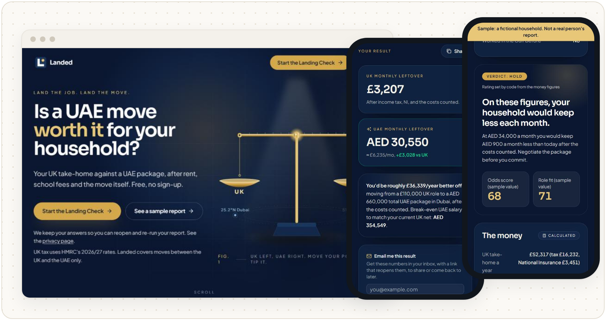
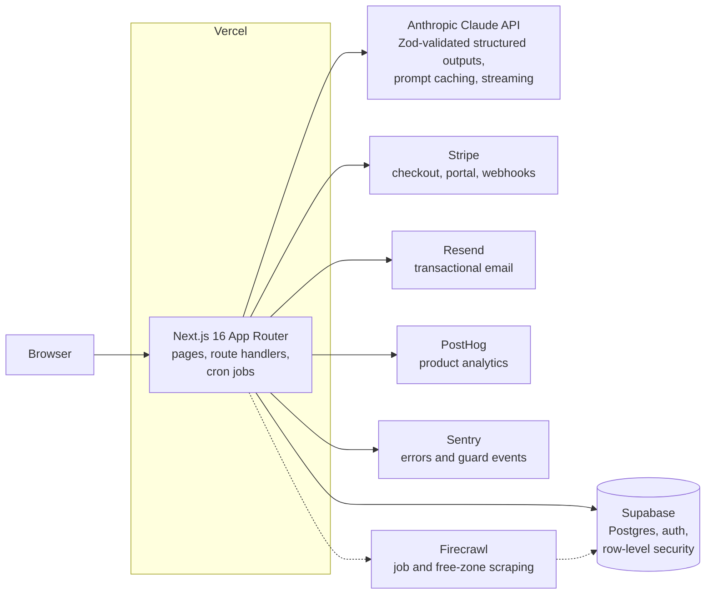
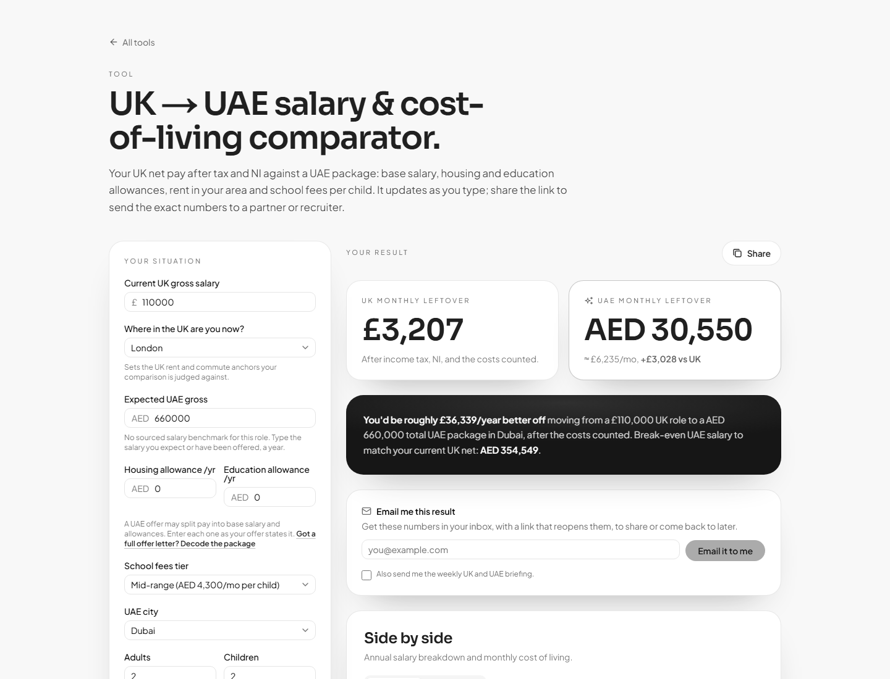
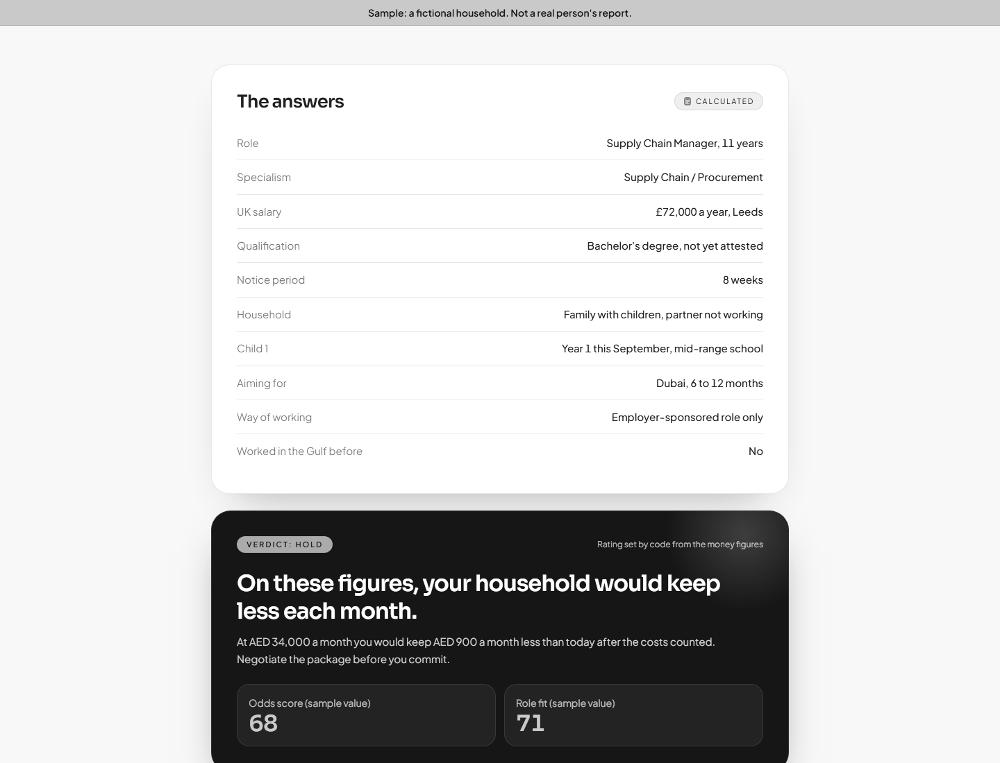
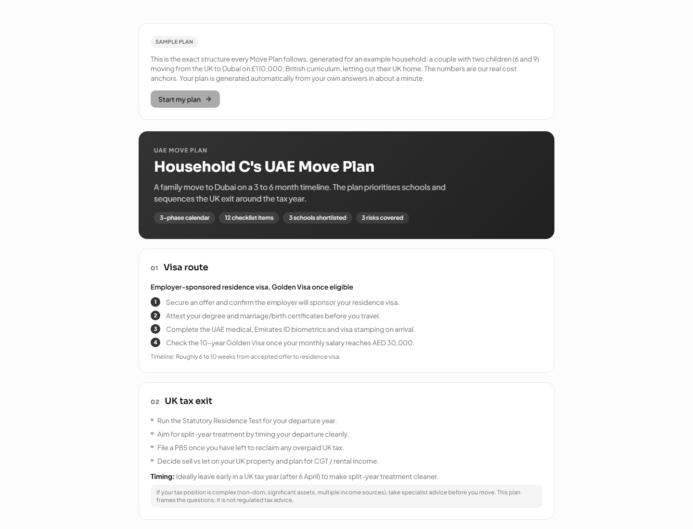

# Landed: case study

A live AI platform for professionals moving from the UK to the UAE, built solo and in open beta at **[landed.guide](https://www.landed.guide)**.

<picture>
  <source media="(prefers-color-scheme: dark)" srcset="docs/landed-dark.png">
  
</picture>

This repo is a case study, not the product's source. The code is private; [`samples/`](samples/) holds four short excerpts.

## The problem

A UK professional weighing a UAE offer wants to know one thing: will my household be better off? The answer sits across many sources. UK take-home depends on tax bands and the personal allowance taper. The UAE side depends on rent paid upfront, school fees, allowances that may or may not be in the offer, and the cost of the move. Most advice says "no income tax" and stops there.

The platform serves UK professionals, many with families, deciding whether to move and then planning the move.

## What it does

- **A scored report.** From role, salary, household and target emirate: an odds score, a verdict (go, go with conditions, or hold), the money left each month after rent and school fees, and the months needed to repay the upfront move cost.
- **Salary and cost-of-living comparator.** UK take-home against a UAE package, and what is left each month on each side. Every input sits in the URL, so a shared link reproduces the result.
- **Move planner.** Around 20 to 28 dated tasks (documents, visas, housing, schools, banking) generated from the user's answers.
- **CV and LinkedIn tools.** A CV checker scored against UAE recruiter criteria, a CV rewriter and a LinkedIn profile optimiser.
- **Document analysis.** An employment contract, passport page or degree certificate (PDF or image) goes in; key fields and issues rated by severity come out.
- **More than 20 further tools and 31 guides**, from an end-of-service gratuity calculator to a UK day counter for tax residence.
- **Voice assistant (in testing).** Answers relocation questions in English and Arabic from the site's guides and runs the salary comparison live. Configuration and test results: [bilingual-voice-agent](https://github.com/husameltahir/bilingual-voice-agent).

## Architecture

- Eleven generators call the SDK's `messages.parse()` or `messages.stream()` with a Zod schema as the output format, so responses arrive typed and validated. Long system prompts carry `cache_control` for prompt caching.
- All 22 Supabase tables have row-level security enabled.
- The Firecrawl routes (dashed) exist in the code but are not on a schedule today.

## Engineering practice

Measured on 5 November 2026:

- **215 pull requests** merged into `main`.
- **98 test files** (`find src -name "*.test.*" | wc -l`), run with Vitest.
- **CI on every code pull request:** type check, ESLint, the copy checks below and the tests; `npm audit`; a lint for SQL migrations and a block on editing migrations already applied.
- **Lint rules for style and sources.** One checker reads every string literal and JSX text through the TypeScript parser and fails on em dashes, en dashes and spaced hyphens. Another fails on credential claims the product cannot back. A test fails if a page writes source text inline instead of using the shared numbered footnotes.
- **Rate limiting.** A rolling one-hour window per user, or per salted hash of the IP address (raw IPs are never stored): 10 an hour for anonymous visitors up to 600 for the top tier, and a separate bucket of 6 an hour for the scored report.
- **A number guard.** Every money figure, percentage and duration in a report's prose is checked against the figures the code calculated. A sentence quoting any other figure is removed before anyone sees it.
- **Feature flags for paid products.** Each paid product sells only when its own flag is exactly `"true"`, so a missing setting means off.

## Decisions I made and why

**The verdict comes from code, not the model.** Early test runs found prose that disagreed with the calculator: a net gain of AED 174,600 where the sum was AED 137,600, and a "45%" rise that was 57%. Now the model writes sentences and an odds score, and code sets the rating: "go" needs a score of 65 or more, a positive monthly advantage and payback within 60 months. If the model's rating differs, code templates replace its headline and summary, and the override is logged.

**Every figure carries a dated source, or it goes.** Each dataset has a row with source, link, checked date and caveat, shown as numbered footnotes. When the salary benchmarks could not be sourced, they were removed, and the comparator asks for the user's own UAE salary instead of guessing.

**Skip builds that cannot change the app.** Each kept deployment stores about 47 MB against a 10 GB limit, and on one day 46 of 185 kept deployments had changed only docs or tooling. A build step now skips the build when every changed file is docs, tooling, a test or root-level Markdown. Any doubt (a first deployment, a git error) builds.

## Screenshots

Greyscale desktop captures. Every screen uses fictional sample data; the live design is at the top of this page.

| | |
| --- | --- |
|  | **Salary comparator.** UK take-home after tax and National Insurance against a UAE package, after rent and school fees, with a break-even UAE salary. |
|  | **Decision report.** The verdict is set by code from the money figures, not by the language model, so it cannot disagree with the numbers. |
|  | **Move plan.** Generated from the household's answers: visa route, UK tax exit, schools and a phased calendar. |

## Code samples

Trimmed excerpts; trims are marked `// ...`.

| File | Shows |
| --- | --- |
| [`01-structured-output.ts`](samples/01-structured-output.ts) | Claude output validated with Zod, prompt caching, fields owned by code |
| [`02-number-guard.ts`](samples/02-number-guard.ts) | The check on figures in generated text |
| [`03-salary-comparison.ts`](samples/03-salary-comparison.ts) | UK tax and National Insurance, and the monthly comparison |
| [`04-number-guard.test.ts`](samples/04-number-guard.test.ts) | The testing style, built from real failures |

## Status

Open beta with small traffic. The free tools are open to everyone; paid products sit behind the flags above.

---

© 2026 Husam El Tahir. All rights reserved. Shown for portfolio review only.
